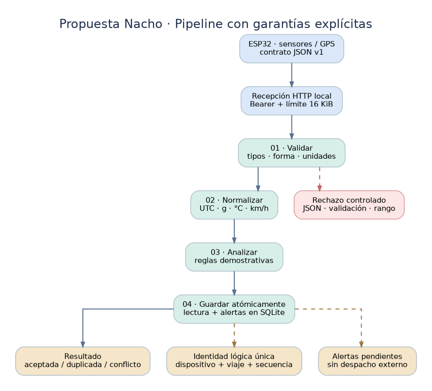

# VECTRA · Análisis y mejora de software (Propuesta Nacho)

**Entrega académica mejorada:** análisis documental + propuesta arquitectónica + prototipo Python ejecutable y probado. La implementación es **nueva y demostrativa**, no un sistema vehicular existente ni un producto listo para producción.



## ¿Qué se mejoró?

- Notebook **C** renovado con diagnóstico fundamentado, decisiones técnicas, matrices de riesgo, diagramas, demostraciones reproducibles, limitaciones y plan de evaluación.
- Contrato JSON v1 con validación estricta, normalización de unidades y fechas con zona horaria.
- Pipeline modular `validador → normalizador → analizador → persistencia atómica` con datos y alertas coherentes.
- SQLite, IDs estables y respuesta diferenciada a nuevas lecturas, duplicados y conflictos.
- HTTP **local** de demostración con token Bearer, solo loopback, límite de mensaje y errores de cliente identificables.
- Pruebas automatizadas sin servicios externos ni sensores, documentación del flujo ESP32 y diagramas PNG/SVG/DOT.

**Preservación de autoría:** `notebooks/01_analisis_y_propuesta_A.ipynb` permanece **sin modificaciones**. La **propuesta B no estaba en el ZIP** y no se atribuye análisis directo de ese material.

## Inicio rápido (Ubuntu / Python 3.11+)

No requiere instalar librerías externas para correr el prototipo o las pruebas.

```bash
python3 -m unittest discover -s tests -v
python3 -m vectra.cli --db data/vectra.sqlite3 demo
python3 -m vectra.cli --db data/vectra.sqlite3 summary
python3 -m vectra.cli --db data/vectra.sqlite3 ingest examples/telemetria_ejemplo.json
```

Si corres `demo` de nuevo en la misma base, devuelve `duplicate`: es un resultado correcto del reenvío idempotente. Borra **solo tu base de demostración** para reiniciar (`rm data/vectra.sqlite3`) con el servidor cerrado.

### API HTTP local

```bash
export VECTRA_API_TOKEN='ejemplo-cambiar-token-mas-de-16-caracteres'
python3 -m vectra.cli --db data/vectra.sqlite3 serve --port 8081
```

En otra terminal:

```bash
curl -i http://127.0.0.1:8081/health
curl -i -X POST http://127.0.0.1:8081/api/v1/telemetry \
  -H "Authorization: Bearer $VECTRA_API_TOKEN" \
  -H 'Content-Type: application/json' \
  --data-binary @examples/telemetria_ejemplo.json
curl -s http://127.0.0.1:8081/api/v1/summary -H "Authorization: Bearer $VECTRA_API_TOKEN"
```

**Dashboard local:** una vez iniciado el servidor, abre `http://127.0.0.1:8081/` en el navegador, introduce el token y pulsa «Conectar y actualizar». El token no se almacena en disco ni en `localStorage`; la consola usa los datos sintéticos persistidos en SQLite.

**Advertencia:** API sin TLS, por diseño **solo accesible en localhost**. No se debe exponer a internet ni al ESP32 de una red abierta. Los umbrales son ilustrativos, no calibrados con datos reales.

## Estructura

```text
notebooks/
  01_analisis_y_propuesta_A.ipynb    # conservado intacto
  03_analisis_y_propuesta_Nacho.ipynb    # análisis mejorado y demostraciones
vectra/
  models.py                          # contratos internos / errores
  validation.py                      # recepción del contrato JSON estricto
  normalization.py                   # unidades y UTC
  anomaly.py                         # reglas demostrativas configurables
  pipeline.py                        # coordinación
  repository.py                      # SQLite: transacciones y duplicados
  simulation.py                      # muestras sintéticas
  http_api.py                        # receptor HTTP local protegido
  static/dashboard.html              # visualización responsiva, sin frameworks
  cli.py                             # demo, ingest, summary, serve
tests/                              # pruebas unitarias e integrales
docs/                               # auditoría, arquitectura, contrato, ESP32
  figures/                           # diagramas DOT + PNG + SVG
examples/                            # ejemplo de JSON
pyproject.toml
```

## Documento principal

Abrir `notebooks/03_analisis_y_propuesta_Nacho.ipynb` desde Jupyter (entorno Python 3.11+); ejecutar de arriba hacia abajo. Sus celdas funcionan con datos sintéticos y guardan SQLite **temporal fuera del repositorio**. Los diagramas están incluidos como imágenes externas junto al documento.

## Qué está y qué no está implementado

**Sí:** dashboard local de consulta, receptor de prueba local, validación, normalización, reglas simples, persistencia y consulta, reenvíos idempotentes, registros de alertas pendientes, pruebas automáticas.

**No:** firmware físico ESP32, integración real con GPS/IMU, dashboard operativo de producción, IA entrenada, envío externo de alertas, seguridad de internet, cola offline en flash, calibración de sensores ni evaluación en campo. Véanse `docs/AUDITORIA.md` y `docs/ESP32_E_INTEGRACION.md`.

## Documentación

- [Auditoría y plan de cierre](docs/AUDITORIA.md)
- [Decisiones de arquitectura y diagramas](docs/ARQUITECTURA.md)
- [Contrato JSON y errores HTTP](docs/CONTRATO_TELEMETRIA.md)
- [Hoja de ruta ESP32 y conectividad](docs/ESP32_E_INTEGRACION.md)
