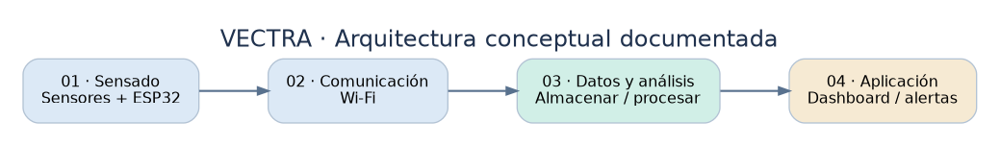
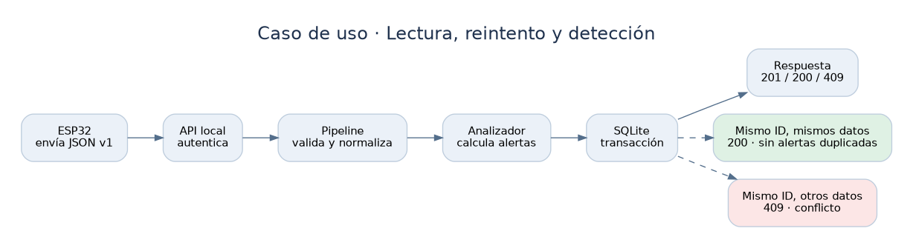

# Arquitectura de referencia · Propuesta Nacho

La representación anterior reconstruye las **cuatro capas conceptuales** explicadas en el material recibido. No constituye ingeniería inversa del código original: tal código no fue proporcionado.

## Diseño interno implementado en el prototipo

| Etapa | Módulo | Entra | Sale | Errores |
|---|---|---|---|---|
| 0. Recepción | `http_api.py`/`cli.py` | JSON UTF-8 | `dict` | 401/413/415, error de parseo |
| 1. Validación | `validation.py` | `dict` | Mensaje conforme a contrato v1 | `ValidationError` |
| 2. Normalización y enriquecimiento | `normalization.py` | `dict` validado | `TelemetryRecord` inmutable (UTC, unidades canónicas, módulo de aceleración) | `ValidationError` |
| 3. Análisis | `anomaly.py` | `TelemetryRecord` | Cero o más `Anomaly` | Fallo programático (no se persiste nada) |
| 4. Persistencia | `repository.py` | Lectura y anomalías | `IngestResult` aceptada o duplicada | `ConflictError`, SQLite |
| 5. Consulta | `repository.py`/`http_api.py` | Filtro acotado | Resumen, recientes, alertas pendientes | Auth HTTP |

**Decisión importante de diseño:** el notebook original describía almacenamiento *antes* de análisis. Aquí el analizador (puro, sin efectos laterales) se ejecuta primero y el repositorio inserta telemetría y alertas en **una sola transacción**. Así no hay un registro aceptado con alertas parcialmente insertadas por un fallo a mitad de operación. No equivale a entrega externa confiable de notificaciones.

**Enriquecimiento:** solo cálculo local de la magnitud de la aceleración, captura de hora de recepción y transporte de identificadores ya presentes; no hay consulta a catálogos de vehículo ni geocodificación. La magnitud incluye gravedad si el IMU la reporta; por eso no debe interpretarse como aceleración lineal de la carrocería.

## Decisiones (ADR resumidas)

- **ADR-01: estándar Python + SQLite.** Razón: ejemplo simple, ejecutable offline y reproducible sin instalar dependencias de terceros. Límite: no destinado a carga horizontal ni a operación 24/7.
- **ADR-02: esquema JSON estricto.** Razón: evitar interpretaciones silenciosas, especialmente de unidades, horarios o campos con errores tipográficos. Límite: versionado de esquema requerido para cambios futuros.
- **ADR-03: unicidad lógica por dispositivo-viaje-secuencia.** Razón: tolerar reenvío después de pérdida de ACK. Límite: el ESP32 debe conservar el contador estable, no reiniciarlo dentro del viaje y manejar su ciclo de vida.
- **ADR-04: regla sin ML.** Razón: no existe un conjunto de datos de referencia ni etiquetas que permitan afirmar validación de IA. Límite: los umbrales son *demostrativos*, sujetos a calibración.
- **ADR-05: HTTP solo loopback.** Razón: posibilidad de probar flujo real de ingesta sin inducir despliegues inseguros en red local o internet. Límite: desde ESP32 real hará falta una pasarela HTTPS o arquitectura de red privada diseñada y verificada.

## Secuencia normal / reintento

- `201`: lectura nueva aceptada y alertas guardadas.
- `200`: mismo ID lógico, mismas mediciones normalizadas (sin duplicar alertas).
- `409`: mismo ID, contenido diferente (conflicto, requiere intervención).
- `422`: datos incorrectos o con unidades desconocidas.
- `401`: token ausente o incorrecto.

## Confidencialidad y amenazas

La ubicación GPS es dato potencialmente sensible. Un diseño real debe limitar su consulta por rol, cifrar tránsito y almacenamiento según amenaza, gestionar periodos de retención, impedir correlaciones innecesarias y ofrecer borrado seguro según la normativa aplicable. La API local **no** dispone de multiusuario, autorización granular, TLS, registros de auditoría ni rate limiting; no debe publicarse.

## Relación con propuestas A y B

A (contenida en el ZIP): división de clases por responsabilidad. C (esta entrega): flujo por etapas y semántica de transacción/deduplicación. B se menciona en el notebook C original, pero **no está incluida en el ZIP**: su descripción no puede verificarse y la comparación nueva se limita a A y C.

## Requisitos pendientes para homologación

Comprobar latencia p50/p95, éxito del reenvío tras desconexión, repetición tras reinicio, exactitud de GPS, estabilidad de sensor/IMU, calibración, consumo, cumplimiento de protección de datos y resistencia de la plataforma al volumen esperado. No se fijan SLA ni tasas sin medir el entorno real.
