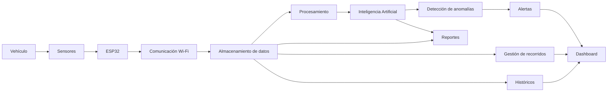
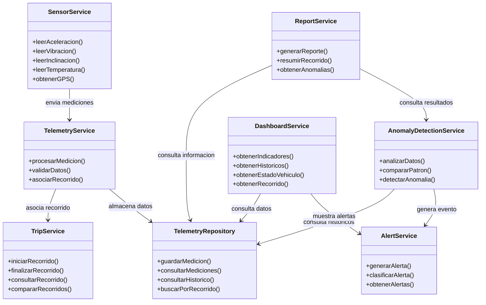

# 1. Diseño original de VECTRA

## 1.1 Descripción general del proyecto

VECTRA, cuyo nombre corresponde a *Vehicle Early-warning & Contextual Telemetry Recognition Analytics*, es un sistema IoT orientado al monitoreo, aprendizaje y detección de anomalías en el comportamiento de un vehículo.

La idea principal del proyecto consiste en convertir un vehículo convencional en una fuente de datos mediante un dispositivo IoT capaz de recopilar información durante los recorridos. A partir de estas mediciones, el sistema busca construir un modelo del comportamiento habitual del vehículo y posteriormente identificar desviaciones respecto a dicho comportamiento.

El objetivo inicial del proyecto no es realizar un diagnóstico mecánico definitivo, sino registrar información objetiva del vehículo, generar un historial de recorridos y detectar comportamientos que se alejen del patrón previamente aprendido.

## 1.2 Estructura conceptual actual

Actualmente, VECTRA se encuentra definido principalmente mediante una arquitectura conceptual. El flujo general del sistema parte del vehículo, continúa con los sensores y el dispositivo ESP32, posteriormente pasa al almacenamiento y análisis de datos y finalmente presenta la información mediante un dashboard.

El flujo general puede representarse de la siguiente manera:

```text
Vehículo
   ↓
Sensores
   ↓
ESP32
   ↓
Datos
   ↓
Inteligencia Artificial
   ↓
Dashboard
```

De manera funcional, el proyecto resume este proceso como:

```text
Medir → Comunicar → Almacenar → Analizar → Detectar → Visualizar
```

## 1.3 Responsabilidades actuales del sistema

Aunque VECTRA todavía no presenta en su documentación una implementación completa dividida en clases de software, sí existen responsabilidades claramente identificables dentro de su diseño conceptual.

### Sensores

Los sensores tienen la responsabilidad de obtener información física y contextual relacionada con el comportamiento del vehículo.

Las variables consideradas en el proyecto son:

- Aceleración en los ejes X, Y y Z.
- Vibración.
- Inclinación.
- Velocidad.
- Temperatura.
- Tiempo.
- Ubicación.

Estas mediciones constituyen la materia prima que posteriormente será procesada por el sistema.

### ESP32

El ESP32 funciona como dispositivo central del sistema IoT.

Sus responsabilidades principales son:

- Recibir las mediciones de los sensores.
- Coordinar la adquisición de información.
- Gestionar la comunicación inalámbrica.
- Enviar los datos hacia la plataforma cuando exista conectividad disponible.

### Comunicación

La parte de comunicación se encarga de transferir las mediciones generadas por el dispositivo IoT hacia la plataforma de procesamiento.

En la propuesta inicial se considera el uso de Wi-Fi para realizar esta comunicación.

### Almacenamiento de datos

El sistema debe conservar las mediciones generadas durante cada recorrido.

Cada recorrido produce una serie temporal que puede incluir:

- Marca de tiempo.
- Latitud.
- Longitud.
- Aceleración.
- Vibración.
- Inclinación.
- Temperatura.
- Velocidad.
- Identificador del recorrido.

La información almacenada posteriormente permitirá consultar históricos y realizar comparaciones entre diferentes recorridos.

### Procesamiento de datos

El procesamiento tiene la responsabilidad de organizar y preparar la información obtenida de los sensores para que pueda ser utilizada por otras partes del sistema.

Entre sus tareas se encuentran:

- Procesar series temporales.
- Comparar información de diferentes recorridos.
- Preparar los datos para el análisis.
- Facilitar el estudio de patrones de comportamiento.

### Inteligencia Artificial

La inteligencia artificial tiene como propósito analizar el comportamiento histórico del vehículo.

La secuencia conceptual propuesta es:

```text
Recopilar datos
      ↓
Aprender patrón normal
      ↓
Comparar recorrido
      ↓
Detectar desviación
```

La IA podría detectar comportamientos como:

- Vibraciones diferentes a las habituales.
- Aceleraciones atípicas.
- Cambios relacionados con determinados recorridos.
- Patrones que aparecen con mayor frecuencia antes de una anomalía.

Una anomalía detectada no necesariamente representa una falla mecánica, sino una diferencia significativa respecto al comportamiento previamente aprendido.

### Sistema de alertas

Cuando se detecta una desviación importante, el sistema debe generar una alerta para informar al usuario.

En la etapa inicial del proyecto se contempla principalmente una alerta visual.

### Dashboard

El dashboard tiene la responsabilidad de presentar la información procesada de forma comprensible.

El objetivo no es mostrar todos los datos crudos al usuario, sino convertir las mediciones en información útil mediante:

- Gráficas.
- Indicadores.
- Históricos.
- Estado del vehículo.
- Alertas.
- Información de los recorridos.

### Gestión de recorridos

VECTRA también debe administrar la información relacionada con los recorridos realizados por el vehículo.

Entre sus responsabilidades están:

- Registrar un recorrido.
- Asociar las mediciones con un recorrido.
- Consultar recorridos anteriores.
- Comparar recorridos.
- Mostrar el trayecto cuando se utilice GPS.

### Reportes

Otra responsabilidad identificada es la generación de reportes.

El sistema debe ser capaz de resumir la información relevante de un recorrido, permitiendo consultar posteriormente datos importantes y anomalías detectadas.

## 1.4 Funcionalidades identificadas

A partir del diseño actual, se identifican las siguientes funcionalidades principales:

1. Registrar recorridos.
2. Obtener mediciones de sensores.
3. Enviar o almacenar mediciones.
4. Visualizar información.
5. Consultar históricos.
6. Comparar recorridos.
7. Detectar anomalías.
8. Generar alertas.
9. Mostrar el recorrido mediante GPS.
10. Generar reportes.

Estas funcionalidades muestran que VECTRA no realiza una sola tarea, sino que combina adquisición de datos, comunicación, almacenamiento, procesamiento, análisis y visualización.

## 1.5 Diagrama del diseño original

El diseño original de VECTRA puede representarse de la siguiente manera:



## 1.6 Observación sobre el diseño original

Es importante aclarar que el proyecto se encuentra actualmente en una etapa conceptual y de prototipado.

Por esta razón, el diseño original presentado en este análisis se construye a partir de las responsabilidades funcionales y componentes definidos en la documentación de VECTRA, y no a partir de una implementación completa de clases ya desarrolladas.

Este análisis servirá como punto de partida para proponer posteriormente una estructura de software basada en clases pequeñas y especializadas.

# 2. Análisis de problemas de diseño

## 2.1 Concentración excesiva de responsabilidades

VECTRA contempla múltiples funciones diferentes dentro de un mismo sistema: adquisición de datos, comunicación, almacenamiento, procesamiento, análisis mediante inteligencia artificial, generación de alertas, visualización en dashboard, gestión de recorridos y generación de reportes.

Si estas funciones se implementaran dentro de una sola clase principal o en un número reducido de componentes, el diseño podría volverse difícil de mantener.

Por ejemplo, una clase encargada simultáneamente de leer sensores, almacenar datos, detectar anomalías y preparar información para el dashboard tendría demasiadas responsabilidades diferentes.

Esto provocaría que una misma clase tuviera múltiples motivos para cambiar.

Un cambio en los sensores, en el almacenamiento o en el algoritmo de detección de anomalías podría obligar a modificar el mismo componente.

## 2.2 Dificultad de mantenimiento

Una clase con muchas responsabilidades suele crecer conforme se agregan nuevas funcionalidades.

En VECTRA esto sería especialmente importante porque el proyecto contempla varias funciones que podrían evolucionar de manera independiente.

Por ejemplo:

- Los sensores utilizados podrían cambiar.
- El método de almacenamiento podría modificarse.
- El algoritmo de detección de anomalías podría mejorar.
- El dashboard podría incluir nuevas gráficas.
- Podrían añadirse nuevos tipos de alertas.
- Los reportes podrían requerir nuevos formatos.

Si toda esta lógica estuviera concentrada en pocos componentes, localizar el código relacionado con una funcionalidad específica sería más complicado.

También aumentaría el riesgo de modificar accidentalmente una parte del sistema que ya funcionaba correctamente.

## 2.3 Alto acoplamiento entre componentes

Otro posible problema es el acoplamiento excesivo.

El acoplamiento ocurre cuando una parte del sistema depende demasiado de la implementación interna de otra.

Por ejemplo, si el módulo encargado de detectar anomalías accediera directamente al código de los sensores y al almacenamiento, cualquier cambio en esos componentes podría obligar a modificar también el algoritmo de análisis.

De la misma forma, el dashboard no debería depender directamente de la forma en que los sensores capturan la información.

El dashboard solamente necesita recibir información procesada que pueda ser mostrada al usuario.

Reducir estas dependencias permite que los componentes evolucionen de manera más independiente.

## 2.4 Dificultad para realizar pruebas

Cuando varias responsabilidades se encuentran mezcladas en una misma clase, también resulta más difícil realizar pruebas.

Por ejemplo, para probar solamente el algoritmo de detección de anomalías no debería ser necesario conectar físicamente el ESP32, los sensores, el GPS y el dashboard.

El componente de análisis debería poder probarse utilizando datos previamente almacenados o datos de prueba.

De la misma manera, debería ser posible probar:

- El almacenamiento sin utilizar inteligencia artificial.
- El dashboard sin conectar sensores reales.
- El sistema de alertas utilizando anomalías simuladas.
- La gestión de recorridos sin ejecutar todo el sistema IoT.

La separación de responsabilidades facilita las pruebas unitarias porque cada componente puede evaluarse de forma individual.

## 2.5 Posible duplicación de código

Si las responsabilidades no se encuentran correctamente separadas, diferentes partes del sistema podrían repetir operaciones similares.

Por ejemplo, la consulta de mediciones históricas podría utilizarse en:

- El dashboard.
- Los reportes.
- La detección de anomalías.
- La comparación de recorridos.

Si cada componente implementara su propia lógica para consultar los datos, existiría código duplicado.

Esto aumentaría el mantenimiento necesario, ya que un cambio en la forma de recuperar los datos tendría que realizarse en varios lugares.

Una estructura mejor organizada debería centralizar las operaciones comunes y permitir que otros componentes las reutilicen.

## 2.6 Dificultad para incorporar nuevas funcionalidades

VECTRA está planteado como un proyecto que puede evolucionar posteriormente.

Por ejemplo, podrían incorporarse nuevas características como:

- Nuevos sensores.
- Nuevos algoritmos de detección.
- Notificaciones por correo electrónico o aplicaciones móviles.
- Gestión de varios vehículos.
- Recomendaciones de mantenimiento.
- Nuevos tipos de reportes.
- Comparaciones entre diferentes vehículos.

Si la estructura del sistema no separa correctamente las responsabilidades, agregar estas funcionalidades podría requerir modificar una gran cantidad de código existente.

Esto aumenta la posibilidad de introducir errores.

Una estructura modular permite agregar nuevos componentes con menor impacto en el resto del sistema.

## 2.7 Dependencia entre la interfaz y la lógica del sistema

Otro problema que debe evitarse es mezclar la lógica del dashboard con el procesamiento de los datos.

La interfaz debe encargarse principalmente de presentar información.

No debería contener directamente la lógica utilizada para:

- Leer sensores.
- Procesar telemetría.
- Detectar anomalías.
- Guardar información.
- Comparar recorridos.

Si la lógica se mezcla con la interfaz, cualquier cambio visual podría afectar procesos internos del sistema.

Separar ambas responsabilidades facilita modificar el dashboard sin alterar el funcionamiento de los demás componentes.

## 2.8 Dificultad para identificar responsabilidades

Cuando una clase realiza demasiadas operaciones, también resulta más difícil comprender cuál es su propósito.

Por ejemplo, una clase llamada `VectraSystem` que contuviera métodos como:

```java
leerSensores();
guardarDatos();
analizarDatos();
detectarAnomalia();
generarAlerta();
mostrarDashboard();
generarReporte();
```

tendría demasiadas responsabilidades.

El nombre de la clase tampoco permitiría identificar claramente qué parte del sistema administra.

Utilizar clases más pequeñas y con nombres específicos permite comprender más fácilmente la estructura del software.

## 2.9 Relación con el Principio de Responsabilidad Única

Los problemas anteriores pueden reducirse aplicando el Principio de Responsabilidad Única o SRP (*Single Responsibility Principle*).

Este principio propone que cada clase tenga una responsabilidad principal claramente definida.

En VECTRA, esto permitiría separar responsabilidades como:

```text id="y67kjg"
Adquisición de datos
        ↓
Procesamiento de telemetría
        ↓
Almacenamiento
        ↓
Gestión de recorridos
        ↓
Detección de anomalías
        ↓
Generación de alertas
        ↓
Visualización
        ↓
Reportes
```

En lugar de concentrar estas operaciones en una sola clase, cada responsabilidad puede asignarse a un componente especializado.

Esta será la base de la propuesta de mejora desarrollada por el integrante 2.

## 2.10 Resumen de los problemas encontrados

| Problema | Consecuencia |
|---|---|
| Exceso de responsabilidades | Clases grandes y difíciles de comprender |
| Alto acoplamiento | Un cambio puede afectar varios componentes |
| Dificultad de mantenimiento | Mayor esfuerzo para localizar y modificar código |
| Dificultad de pruebas | Se necesita ejecutar componentes innecesarios |
| Duplicación de código | La misma lógica puede aparecer en varios lugares |
| Baja reutilización | Las funciones quedan ligadas a componentes específicos |
| Poca extensibilidad | Agregar funciones puede afectar código existente |
| Mezcla entre interfaz y lógica | Cambios visuales pueden afectar procesos internos |

Por estas razones, se considera conveniente reorganizar el software de VECTRA mediante componentes especializados y con responsabilidades claramente definidas.

# 3. Propuesta de mejora aplicando el Principio de Responsabilidad Única

## 3.1 Principio utilizado

Para mejorar la organización del software de VECTRA se propone aplicar el Principio de Responsabilidad Única, conocido como SRP por sus siglas en inglés (*Single Responsibility Principle*).

La idea principal de este principio es que cada clase debe tener una responsabilidad principal claramente definida.

Esto significa que una clase no debería encargarse al mismo tiempo de obtener datos de sensores, almacenar información, detectar anomalías, generar alertas y preparar información para el dashboard.

Separar estas funciones permite que cada componente tenga un propósito específico y pueda modificarse de manera más independiente.

En VECTRA, las responsabilidades principales identificadas pueden dividirse en:

- Adquisición de datos.
- Procesamiento de telemetría.
- Gestión de recorridos.
- Persistencia de información.
- Detección de anomalías.
- Generación de alertas.
- Preparación de información para visualización.
- Generación de reportes.

A partir de estas responsabilidades se propone crear diferentes clases especializadas.

---

## 3.2 Estructura general propuesta

La propuesta del integrante 2 divide el software de VECTRA en las siguientes clases:

```text
SensorService
TelemetryService
TripService
TelemetryRepository
AnomalyDetectionService
AlertService
DashboardService
ReportService
```

Cada clase tendrá una responsabilidad principal dentro del sistema.

La estructura general puede entenderse de la siguiente manera:

```text
Sensores
   ↓
SensorService
   ↓
TelemetryService
   ├──────────────→ TripService
   │
   ↓
TelemetryRepository
   ↓
AnomalyDetectionService
   ↓
AlertService

TelemetryRepository ─────→ DashboardService
TelemetryRepository ─────→ ReportService

AlertService ─────────────→ DashboardService
AnomalyDetectionService ─→ ReportService
```

---

# 3.3 SensorService

## Responsabilidad

`SensorService` será responsable exclusivamente de obtener las mediciones provenientes de los sensores instalados en el vehículo.

No deberá encargarse de guardar los datos, analizarlos o mostrarlos en el dashboard.

Su responsabilidad termina una vez que obtiene las mediciones necesarias y las entrega al componente encargado de procesarlas.

## Funciones propuestas

```java
leerAceleracion()
leerVibracion()
leerInclinacion()
leerTemperatura()
obtenerGPS()
```

## Ejemplo conceptual

```java
public class SensorService {

    public void leerAceleracion() {
        System.out.println("Leyendo aceleración...");
    }

    public void leerVibracion() {
        System.out.println("Leyendo vibración...");
    }

    public void leerTemperatura() {
        System.out.println("Leyendo temperatura...");
    }

    public void obtenerGPS() {
        System.out.println("Obteniendo ubicación...");
    }
}
```

## Justificación

Esta separación permite que los sensores puedan cambiar sin afectar directamente el resto del sistema.

Por ejemplo, si en el futuro se reemplaza el sensor de movimiento utilizado por VECTRA, los principales cambios se concentrarían en este componente.

---

# 3.4 TelemetryService

## Responsabilidad

`TelemetryService` será responsable de recibir, organizar y validar las mediciones obtenidas de los sensores.

Su función será preparar los datos antes de que sean almacenados o utilizados por otros componentes.

## Funciones propuestas

```java
procesarMedicion()
validarDatos()
asociarRecorrido()
```

## Ejemplo conceptual

```java
public class TelemetryService {

    public void procesarMedicion() {
        System.out.println("Procesando telemetría...");
    }

    public void validarDatos() {
        System.out.println("Validando datos...");
    }

    public void asociarRecorrido() {
        System.out.println("Asociando mediciones al recorrido...");
    }
}
```

## Justificación

La información obtenida por los sensores puede requerir validación y organización antes de almacenarse.

Separar este procesamiento evita que `SensorService` tenga que conocer cómo se almacenan o analizan los datos.

---

# 3.5 TripService

## Responsabilidad

`TripService` será responsable de administrar los recorridos realizados por el vehículo.

Cada conjunto de mediciones deberá estar asociado a un recorrido determinado.

## Funciones propuestas

```java
iniciarRecorrido()
finalizarRecorrido()
consultarRecorrido()
compararRecorridos()
```

## Ejemplo conceptual

```java
public class TripService {

    public void iniciarRecorrido() {
        System.out.println("Iniciando recorrido...");
    }

    public void finalizarRecorrido() {
        System.out.println("Finalizando recorrido...");
    }

    public void consultarRecorrido() {
        System.out.println("Consultando recorrido...");
    }
}
```

## Justificación

La gestión de recorridos es una responsabilidad diferente al análisis de telemetría.

Al separarla, el sistema puede administrar recorridos sin depender directamente del algoritmo de inteligencia artificial.

---

# 3.6 TelemetryRepository

## Responsabilidad

`TelemetryRepository` será responsable exclusivamente de almacenar y recuperar la información de telemetría.

Esta clase representa la separación entre la lógica del sistema y la forma en que se almacenan los datos.

## Funciones propuestas

```java
guardarMedicion()
consultarMediciones()
consultarHistorico()
buscarPorRecorrido()
```

## Ejemplo conceptual

```java
public class TelemetryRepository {

    public void guardarMedicion() {
        System.out.println("Guardando medición...");
    }

    public void consultarMediciones() {
        System.out.println("Consultando mediciones...");
    }

    public void consultarHistorico() {
        System.out.println("Consultando histórico...");
    }
}
```

## Justificación

Centralizar el acceso a datos evita que diferentes componentes implementen su propia lógica de almacenamiento.

Por ejemplo, tanto el dashboard como el módulo de inteligencia artificial pueden necesitar información histórica.

En lugar de escribir consultas independientes en cada componente, ambos pueden utilizar `TelemetryRepository`.

Esto reduce la duplicación de código.

---

# 3.7 AnomalyDetectionService

## Responsabilidad

`AnomalyDetectionService` será responsable de analizar los datos y determinar si el comportamiento actual del vehículo se aleja de su patrón habitual.

Este componente representa la parte de análisis e inteligencia artificial de VECTRA.

## Funciones propuestas

```java
analizarDatos()
compararPatron()
detectarAnomalia()
```

## Ejemplo conceptual

```java
public class AnomalyDetectionService {

    public void analizarDatos() {
        System.out.println("Analizando datos...");
    }

    public void compararPatron() {
        System.out.println("Comparando con patrón normal...");
    }

    public void detectarAnomalia() {
        System.out.println("Buscando anomalías...");
    }
}
```

## Justificación

La detección de anomalías puede evolucionar considerablemente durante el proyecto.

En una primera versión podría utilizarse un método sencillo y posteriormente podría incorporarse un modelo de inteligencia artificial más avanzado.

Gracias a esta separación, cambiar el algoritmo de detección no requeriría modificar directamente los componentes responsables de los sensores, recorridos o dashboard.

---

# 3.8 AlertService

## Responsabilidad

`AlertService` será responsable de generar y administrar las alertas del sistema cuando se detecte una desviación relevante.

## Funciones propuestas

```java
generarAlerta()
clasificarAlerta()
obtenerAlertas()
```

## Ejemplo conceptual

```java
public class AlertService {

    public void generarAlerta() {
        System.out.println("Generando alerta...");
    }

    public void clasificarAlerta() {
        System.out.println("Clasificando alerta...");
    }
}
```

## Justificación

Detectar una anomalía y comunicarla al usuario son responsabilidades distintas.

`AnomalyDetectionService` debe determinar si existe una desviación.

`AlertService` debe decidir cómo representar o administrar dicha alerta.

Esto permitiría que en el futuro VECTRA pudiera incorporar diferentes métodos de notificación sin modificar el algoritmo de detección.

Por ejemplo:

```text
Alerta visual
Correo electrónico
Notificación móvil
Mensaje al administrador
```

---

# 3.9 DashboardService

## Responsabilidad

`DashboardService` será responsable de preparar la información necesaria para la interfaz gráfica.

No será responsable directamente de leer sensores ni ejecutar algoritmos de inteligencia artificial.

## Funciones propuestas

```java
obtenerIndicadores()
obtenerHistoricos()
obtenerEstadoVehiculo()
obtenerRecorrido()
```

## Ejemplo conceptual

```java
public class DashboardService {

    public void obtenerIndicadores() {
        System.out.println("Preparando indicadores...");
    }

    public void obtenerHistoricos() {
        System.out.println("Preparando históricos...");
    }

    public void obtenerEstadoVehiculo() {
        System.out.println("Obteniendo estado...");
    }
}
```

## Justificación

El dashboard debe concentrarse en preparar y presentar información.

Separarlo de la lógica de análisis permite modificar la interfaz sin alterar el procesamiento interno del sistema.

Por ejemplo, VECTRA podría cambiar de una aplicación web a una aplicación móvil y conservar gran parte de la lógica del sistema.

---

# 3.10 ReportService

## Responsabilidad

`ReportService` será responsable de generar resúmenes y reportes relacionados con los recorridos y las mediciones.

## Funciones propuestas

```java
generarReporte()
resumirRecorrido()
obtenerAnomalias()
```

## Ejemplo conceptual

```java
public class ReportService {

    public void generarReporte() {
        System.out.println("Generando reporte...");
    }

    public void resumirRecorrido() {
        System.out.println("Generando resumen del recorrido...");
    }
}
```

## Justificación

La generación de reportes es una responsabilidad distinta de la visualización en tiempo real.

El dashboard puede mostrar información actual, mientras que `ReportService` puede generar resultados resumidos para su consulta posterior.

Separar ambas funciones facilita modificar el formato de los reportes sin afectar directamente la interfaz.

---

# 3.11 Relaciones entre las clases

Las clases propuestas no funcionan de forma completamente independiente.

Existen relaciones necesarias entre ellas.

## SensorService → TelemetryService

`SensorService` obtiene las mediciones y las entrega a `TelemetryService`.

```text
SensorService
      ↓
TelemetryService
```

## TelemetryService → TelemetryRepository

Después de validar y organizar las mediciones, `TelemetryService` puede solicitar que sean almacenadas.

```text
TelemetryService
      ↓
TelemetryRepository
```

## TelemetryService → TripService

Las mediciones necesitan asociarse con el recorrido correspondiente.

```text
TelemetryService
      ↓
TripService
```

## AnomalyDetectionService → TelemetryRepository

El sistema de detección necesita consultar datos históricos para comparar el comportamiento actual con recorridos anteriores.

```text
TelemetryRepository
      ↓
AnomalyDetectionService
```

## AnomalyDetectionService → AlertService

Cuando se identifica una desviación relevante, se genera una alerta.

```text
AnomalyDetectionService
      ↓
AlertService
```

## TelemetryRepository → DashboardService

El dashboard necesita consultar información almacenada para presentar históricos e indicadores.

```text
TelemetryRepository
      ↓
DashboardService
```

## AlertService → DashboardService

Las alertas generadas también deben poder mostrarse en la interfaz.

```text
AlertService
      ↓
DashboardService
```

## TelemetryRepository → ReportService

Los reportes necesitan consultar las mediciones almacenadas.

```text
TelemetryRepository
      ↓
ReportService
```

---

# 3.12 Flujo propuesto

Con la nueva estructura, un recorrido podría procesarse de la siguiente manera:

```text
1. El vehículo inicia un recorrido
                ↓
2. TripService registra el recorrido
                ↓
3. SensorService obtiene mediciones
                ↓
4. TelemetryService valida y organiza los datos
                ↓
5. TelemetryRepository almacena las mediciones
                ↓
6. AnomalyDetectionService analiza los datos
                ↓
7. Se compara el comportamiento con el patrón habitual
                ↓
8. Si existe una desviación:
                ↓
9. AlertService genera una alerta
                ↓
10. DashboardService presenta los resultados
                ↓
11. ReportService puede generar un resumen del recorrido
```

Este flujo conserva las funciones previstas originalmente para VECTRA, pero distribuye las responsabilidades entre componentes especializados.

---

# 3.13 Comparación conceptual inicial

## Antes

Una implementación poco organizada podría terminar concentrando operaciones como:

```java
public class VectraSystem {

    public void leerSensores() {}

    public void registrarRecorrido() {}

    public void guardarMediciones() {}

    public void analizarDatos() {}

    public void detectarAnomalia() {}

    public void generarAlerta() {}

    public void mostrarDashboard() {}

    public void generarReporte() {}
}
```

Esta clase tendría demasiadas responsabilidades.

## Propuesta

La nueva estructura distribuye esas operaciones:

```text
VectraSystem
      │
      ├── SensorService
      ├── TelemetryService
      ├── TripService
      ├── TelemetryRepository
      ├── AnomalyDetectionService
      ├── AlertService
      ├── DashboardService
      └── ReportService
```

De esta forma, cada componente tiene una responsabilidad más específica y clara.

---

# 3.14 Resultado de la propuesta

La separación funcional propuesta busca que VECTRA tenga una estructura más sencilla de comprender y modificar.

En lugar de concentrar todas las operaciones dentro de un solo componente, las responsabilidades se distribuyen según su función.

La propuesta permite que cambios futuros, como incorporar un nuevo sensor, modificar el algoritmo de inteligencia artificial, cambiar el sistema de almacenamiento o agregar nuevas formas de notificación, puedan realizarse con menor impacto sobre las demás partes del software.

# 4. Diagrama UML de la propuesta mejorada

La propuesta del integrante 2 reorganiza VECTRA mediante clases especializadas, aplicando el Principio de Responsabilidad Única.

El siguiente diagrama muestra las clases principales, sus funciones y las relaciones entre ellas.



## 4.1 Interpretación del diagrama

El flujo inicia en `SensorService`, que obtiene las mediciones provenientes de los sensores del vehículo.

Estas mediciones son enviadas a `TelemetryService`, responsable de validar, organizar y preparar la información.

`TelemetryService` también se relaciona con `TripService`, ya que las mediciones deben asociarse con un recorrido específico.

Posteriormente, la información es almacenada mediante `TelemetryRepository`.

`AnomalyDetectionService` consulta los datos almacenados para analizar el comportamiento del vehículo y determinar si existe alguna desviación respecto al patrón habitual.

Cuando se detecta una anomalía, `AlertService` administra la generación de la alerta.

Por otra parte, `DashboardService` consulta los datos y las alertas para preparar la información que será presentada al usuario.

Finalmente, `ReportService` utiliza la información almacenada y los resultados del análisis para generar reportes y resúmenes de los recorridos.

## 4.2 Relación con el funcionamiento de VECTRA

La estructura propuesta conserva el flujo funcional original del proyecto:

```text id="0yx5qn"
Medir
  ↓
Procesar
  ↓
Almacenar
  ↓
Analizar
  ↓
Detectar
  ↓
Alertar
  ↓
Visualizar / Reportar
```

La diferencia principal es que ahora cada etapa está representada por una clase especializada.

## 4.3 Separación de responsabilidades

La responsabilidad principal de cada clase es la siguiente:

| Clase | Responsabilidad principal |
|---|---|
| `SensorService` | Obtener mediciones de los sensores |
| `TelemetryService` | Validar y procesar telemetría |
| `TripService` | Gestionar recorridos |
| `TelemetryRepository` | Persistir y consultar datos |
| `AnomalyDetectionService` | Detectar desviaciones |
| `AlertService` | Administrar alertas |
| `DashboardService` | Preparar información para visualización |
| `ReportService` | Generar reportes |

Esta distribución permite identificar claramente qué componente debe modificarse cuando cambia una funcionalidad específica.

## 4.4 Ejemplo de impacto de cambios

Si VECTRA incorporara un nuevo sensor, los principales cambios se realizarían en `SensorService`.

Si se cambiara el algoritmo utilizado para detectar anomalías, el cambio se concentraría principalmente en `AnomalyDetectionService`.

Si se agregara una nueva forma de alerta, el cambio se realizaría principalmente en `AlertService`.

Si el formato de los reportes cambiara, se modificaría `ReportService`.

De esta forma, las modificaciones tienen un impacto más localizado y reducen la necesidad de cambiar componentes que no están directamente relacionados.

# 5. Comparación entre el diseño original y el diseño mejorado

## 5.1 Comparación general

El diseño conceptual original de VECTRA describe un flujo formado por sensado, comunicación, almacenamiento, análisis y visualización.

Este diseño es adecuado para representar el funcionamiento general del sistema, pero todavía no define una organización detallada del software mediante clases especializadas.

La propuesta del integrante 2 toma esas responsabilidades funcionales y las distribuye en componentes independientes.

La comparación general es la siguiente:

| Aspecto | Diseño original | Diseño mejorado |
|---|---|---|
| Organización | Flujo conceptual por etapas | Clases especializadas por responsabilidad |
| Sensado | Sensores y ESP32 | `SensorService` |
| Procesamiento de mediciones | Integrado conceptualmente en datos/procesamiento | `TelemetryService` |
| Gestión de recorridos | Funcionalidad general del sistema | `TripService` |
| Almacenamiento | Componente general de datos | `TelemetryRepository` |
| Detección de anomalías | Parte del análisis e IA | `AnomalyDetectionService` |
| Alertas | Parte de la aplicación | `AlertService` |
| Visualización | Dashboard general | `DashboardService` |
| Reportes | Funcionalidad del sistema | `ReportService` |
| Responsabilidades | Representadas a nivel conceptual | Distribuidas explícitamente entre clases |
| Mantenimiento | Puede volverse complejo al crecer | Cambios más localizados |
| Pruebas | Dependen de varios componentes | Cada servicio puede probarse por separado |
| Reutilización | No está definida claramente | Servicios reutilizables |
| Extensibilidad | Requiere ampliar el diseño general | Se pueden agregar nuevas clases |

---

## 5.2 Diferencia principal

La principal diferencia entre ambos diseños no consiste en cambiar el funcionamiento de VECTRA.

El sistema sigue realizando las mismas actividades principales:

```text
Medir → Comunicar → Almacenar → Analizar → Detectar → Visualizar
```

La mejora consiste en definir de manera más clara qué componente de software será responsable de cada actividad.

En el diseño propuesto, las responsabilidades se distribuyen de la siguiente manera:

```text
SensorService
      ↓
TelemetryService
      ↓
TelemetryRepository
      ↓
AnomalyDetectionService
      ↓
AlertService
      ↓
DashboardService
```

Además, `TripService` administra los recorridos y `ReportService` genera los reportes.

Esta separación permite que el sistema mantenga el flujo funcional original, pero con una estructura de software más organizada.

# 6. Beneficios de la solución propuesta

## 6.1 Facilidad de mantenimiento

Uno de los principales beneficios es la facilidad de mantenimiento.

En una estructura con responsabilidades claramente separadas, cada modificación puede realizarse principalmente en el componente relacionado con esa funcionalidad.

Por ejemplo:

- Un cambio en la lectura de sensores se realizaría principalmente en `SensorService`.
- Un cambio en la validación de telemetría afectaría principalmente a `TelemetryService`.
- Una modificación en el almacenamiento se concentraría en `TelemetryRepository`.
- Un nuevo algoritmo de detección se implementaría principalmente en `AnomalyDetectionService`.
- Un cambio en los reportes se realizaría en `ReportService`.

Esto reduce la necesidad de modificar varias partes del sistema para realizar un cambio pequeño.

También facilita localizar errores, ya que cada clase tiene un propósito específico.

---

## 6.2 Reutilización del código

La nueva estructura permite reutilizar funcionalidades desde distintos componentes del sistema.

Por ejemplo, los históricos almacenados mediante `TelemetryRepository` pueden ser utilizados por:

- `DashboardService`.
- `AnomalyDetectionService`.
- `ReportService`.

En lugar de que cada clase implemente su propio mecanismo para obtener las mediciones, todas pueden utilizar un mismo componente responsable del acceso a datos.

Esto disminuye la duplicación de código y permite mantener una única implementación para operaciones comunes.

Otro ejemplo es `TripService`, que puede ser utilizado tanto para consultar información de un recorrido como para relacionar mediciones con una sesión determinada.

---

## 6.3 Facilidad para realizar pruebas

La separación de responsabilidades facilita considerablemente las pruebas del sistema.

Cada servicio puede ser probado individualmente sin necesidad de ejecutar todo VECTRA.

Por ejemplo, para probar `AnomalyDetectionService` pueden proporcionarse datos históricos previamente preparados.

No sería necesario conectar físicamente:

- El vehículo.
- El ESP32.
- Los sensores.
- El GPS.
- El dashboard.

De igual forma, `AlertService` puede probarse utilizando una anomalía simulada.

`TelemetryRepository` puede probarse verificando que almacene y recupere correctamente la información.

`TripService` puede probarse verificando el inicio, cierre y consulta de recorridos.

Esta separación facilita la creación de pruebas unitarias.

---

## 6.4 Menor acoplamiento

La propuesta también busca reducir el acoplamiento entre los componentes.

Por ejemplo, el dashboard no necesita conocer cómo funcionan físicamente los sensores.

Su responsabilidad es obtener información procesada y presentarla.

De manera similar, `AnomalyDetectionService` no debería encargarse de controlar directamente el ESP32.

Este servicio necesita recibir o consultar datos para analizarlos, pero no necesita conocer los detalles físicos de cómo fueron capturados.

Al reducir estas dependencias, los componentes pueden cambiar de forma más independiente.

---

## 6.5 Mayor claridad del código

Los nombres de las clases permiten identificar fácilmente qué función realiza cada componente.

Por ejemplo:

```text
SensorService
```

indica que el componente trabaja con los sensores.

```text
AnomalyDetectionService
```

indica que su función se relaciona con la detección de anomalías.

```text
ReportService
```

indica que su función es generar reportes.

Esta organización facilita que un nuevo integrante del equipo comprenda la estructura del sistema y encuentre más rápidamente el código relacionado con una funcionalidad.

---

## 6.6 Facilidad para incorporar nuevas funcionalidades

La estructura propuesta facilita la evolución futura de VECTRA.

Si posteriormente se necesitan nuevas funciones, podrían agregarse mediante nuevos componentes especializados.

Por ejemplo:

```text
NotificationService
```

podría administrar notificaciones externas como correos electrónicos o mensajes móviles.

```text
VehicleService
```

podría administrar varios vehículos registrados.

```text
UserService
```

podría encargarse de propietarios, conductores, supervisores y administradores.

```text
MaintenanceRecommendationService
```

podría generar recomendaciones basadas en el historial de comportamiento.

Estas nuevas clases podrían incorporarse sin modificar completamente los componentes existentes.

---

## 6.7 Posibilidad de cambiar tecnologías

Otra ventaja de separar responsabilidades es que permite modificar tecnologías específicas con menor impacto.

Por ejemplo, si inicialmente las mediciones se almacenan en una base de datos determinada y posteriormente se decide utilizar otra tecnología de almacenamiento, el cambio podría concentrarse principalmente en la implementación relacionada con `TelemetryRepository`.

De forma similar, si se cambia la interfaz web por una aplicación móvil, la lógica de detección de anomalías puede conservarse.

También sería posible reemplazar un algoritmo inicial por un modelo de inteligencia artificial más avanzado sin modificar directamente la captura de datos.

---

## 6.8 Mejor trabajo colaborativo

Una estructura dividida por responsabilidades también facilita el trabajo entre los integrantes del equipo.

Diferentes desarrolladores podrían trabajar sobre componentes distintos.

Por ejemplo:

```text
Integrante A → SensorService
Integrante B → AnomalyDetectionService
Integrante C → DashboardService
Integrante D → TelemetryRepository
```

Esto disminuye la posibilidad de que varias personas modifiquen constantemente el mismo archivo y facilita el uso de ramas y commits separados en GitHub.

---

# 7. Ejemplos de evolución del sistema

## Caso 1: agregar un nuevo sensor

Supongamos que posteriormente se incorpora un sensor adicional.

En un diseño con responsabilidades mezcladas podría ser necesario modificar una clase muy grande que también contiene almacenamiento, análisis y visualización.

En la propuesta mejorada, el cambio se concentraría principalmente en:

```text
SensorService
```

El resto del flujo puede continuar funcionando con la misma estructura.

---

## Caso 2: cambiar el algoritmo de inteligencia artificial

VECTRA inicialmente plantea un enfoque de detección de anomalías.

Posteriormente podría utilizarse un algoritmo diferente.

En la estructura propuesta se modificaría principalmente:

```text
AnomalyDetectionService
```

No debería ser necesario modificar la lectura de sensores ni la generación del dashboard.

---

## Caso 3: incorporar notificaciones por correo electrónico

Actualmente el sistema considera principalmente la generación de alertas visuales.

Si posteriormente se desea enviar una notificación por correo, podría crearse:

```text
NotificationService
```

y relacionarlo con:

```text
AlertService
       ↓
NotificationService
```

De esta manera se agrega una nueva función sin modificar completamente el sistema.

---

## Caso 4: generar nuevos tipos de reportes

Si el usuario necesita un reporte adicional, la lógica podría agregarse principalmente en:

```text
ReportService
```

La detección de anomalías y la lectura de sensores podrían mantenerse sin cambios.

---

# 8. Justificación final de la mejora

La propuesta representa una mejora porque transforma las responsabilidades conceptuales de VECTRA en componentes de software especializados.

Cada clase tiene un propósito más específico y puede evolucionar con menor impacto sobre las demás.

La aplicación del Principio de Responsabilidad Única permite:

- Reducir la complejidad de las clases.
- Facilitar el mantenimiento.
- Evitar duplicación de código.
- Disminuir dependencias innecesarias.
- Facilitar pruebas unitarias.
- Favorecer la reutilización de componentes.
- Permitir que el sistema incorpore nuevas funcionalidades.
- Facilitar el trabajo colaborativo.

La estructura propuesta mantiene los objetivos originales de VECTRA, pero establece una organización de software más clara para su futura implementación y crecimiento.
