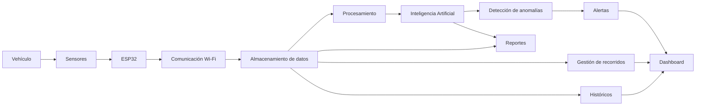

# 1. Diseño original de VECTRA

## 1.1 Descripción general del proyecto

VECTRA, cuyo nombre corresponde a *Vehicle Early-warning & Contextual Telemetry Recognition Analytics*, es un sistema IoT orientado al monitoreo, aprendizaje y detección de anomalías en el comportamiento de un vehículo.

La idea principal del proyecto consiste en convertir un vehículo convencional en una fuente de datos mediante un dispositivo IoT capaz de recopilar información durante los recorridos. A partir de estas mediciones, el sistema busca construir un modelo del comportamiento habitual del vehículo y posteriormente identificar desviaciones respecto a dicho comportamiento.

El objetivo inicial del proyecto no es realizar un diagnóstico mecánico definitivo, sino registrar información objetiva del vehículo, generar un historial de recorridos y detectar comportamientos que se alejen del patrón previamente aprendido.

## 1.2 Estructura conceptual actual

Actualmente, VECTRA se encuentra definido principalmente mediante una arquitectura conceptual. El flujo general del sistema parte del vehículo, continúa con los sensores y el dispositivo ESP32, posteriormente pasa al almacenamiento y análisis de datos y finalmente presenta la información mediante un dashboard.

El flujo general puede representarse de la siguiente manera:

```text
Vehículo
   ↓
Sensores
   ↓
ESP32
   ↓
Datos
   ↓
Inteligencia Artificial
   ↓
Dashboard
```

De manera funcional, el proyecto resume este proceso como:

```text
Medir → Comunicar → Almacenar → Analizar → Detectar → Visualizar
```

## 1.3 Responsabilidades actuales del sistema

Aunque VECTRA todavía no presenta en su documentación una implementación completa dividida en clases de software, sí existen responsabilidades claramente identificables dentro de su diseño conceptual.

### Sensores

Los sensores tienen la responsabilidad de obtener información física y contextual relacionada con el comportamiento del vehículo.

Las variables consideradas en el proyecto son:

- Aceleración en los ejes X, Y y Z.
- Vibración.
- Inclinación.
- Velocidad.
- Temperatura.
- Tiempo.
- Ubicación.

Estas mediciones constituyen la materia prima que posteriormente será procesada por el sistema.

### ESP32

El ESP32 funciona como dispositivo central del sistema IoT.

Sus responsabilidades principales son:

- Recibir las mediciones de los sensores.
- Coordinar la adquisición de información.
- Gestionar la comunicación inalámbrica.
- Enviar los datos hacia la plataforma cuando exista conectividad disponible.

### Comunicación

La parte de comunicación se encarga de transferir las mediciones generadas por el dispositivo IoT hacia la plataforma de procesamiento.

En la propuesta inicial se considera el uso de Wi-Fi para realizar esta comunicación.

### Almacenamiento de datos

El sistema debe conservar las mediciones generadas durante cada recorrido.

Cada recorrido produce una serie temporal que puede incluir:

- Marca de tiempo.
- Latitud.
- Longitud.
- Aceleración.
- Vibración.
- Inclinación.
- Temperatura.
- Velocidad.
- Identificador del recorrido.

La información almacenada posteriormente permitirá consultar históricos y realizar comparaciones entre diferentes recorridos.

### Procesamiento de datos

El procesamiento tiene la responsabilidad de organizar y preparar la información obtenida de los sensores para que pueda ser utilizada por otras partes del sistema.

Entre sus tareas se encuentran:

- Procesar series temporales.
- Comparar información de diferentes recorridos.
- Preparar los datos para el análisis.
- Facilitar el estudio de patrones de comportamiento.

### Inteligencia Artificial

La inteligencia artificial tiene como propósito analizar el comportamiento histórico del vehículo.

La secuencia conceptual propuesta es:

```text
Recopilar datos
      ↓
Aprender patrón normal
      ↓
Comparar recorrido
      ↓
Detectar desviación
```

La IA podría detectar comportamientos como:

- Vibraciones diferentes a las habituales.
- Aceleraciones atípicas.
- Cambios relacionados con determinados recorridos.
- Patrones que aparecen con mayor frecuencia antes de una anomalía.

Una anomalía detectada no necesariamente representa una falla mecánica, sino una diferencia significativa respecto al comportamiento previamente aprendido.

### Sistema de alertas

Cuando se detecta una desviación importante, el sistema debe generar una alerta para informar al usuario.

En la etapa inicial del proyecto se contempla principalmente una alerta visual.

### Dashboard

El dashboard tiene la responsabilidad de presentar la información procesada de forma comprensible.

El objetivo no es mostrar todos los datos crudos al usuario, sino convertir las mediciones en información útil mediante:

- Gráficas.
- Indicadores.
- Históricos.
- Estado del vehículo.
- Alertas.
- Información de los recorridos.

### Gestión de recorridos

VECTRA también debe administrar la información relacionada con los recorridos realizados por el vehículo.

Entre sus responsabilidades están:

- Registrar un recorrido.
- Asociar las mediciones con un recorrido.
- Consultar recorridos anteriores.
- Comparar recorridos.
- Mostrar el trayecto cuando se utilice GPS.

### Reportes

Otra responsabilidad identificada es la generación de reportes.

El sistema debe ser capaz de resumir la información relevante de un recorrido, permitiendo consultar posteriormente datos importantes y anomalías detectadas.

## 1.4 Funcionalidades identificadas

A partir del diseño actual, se identifican las siguientes funcionalidades principales:

1. Registrar recorridos.
2. Obtener mediciones de sensores.
3. Enviar o almacenar mediciones.
4. Visualizar información.
5. Consultar históricos.
6. Comparar recorridos.
7. Detectar anomalías.
8. Generar alertas.
9. Mostrar el recorrido mediante GPS.
10. Generar reportes.

Estas funcionalidades muestran que VECTRA no realiza una sola tarea, sino que combina adquisición de datos, comunicación, almacenamiento, procesamiento, análisis y visualización.

## 1.5 Diagrama del diseño original

El diseño original de VECTRA puede representarse de la siguiente manera:



## 1.6 Observación sobre el diseño original

Es importante aclarar que el proyecto se encuentra actualmente en una etapa conceptual y de prototipado.

Por esta razón, el diseño original presentado en este análisis se construye a partir de las responsabilidades funcionales y componentes definidos en la documentación de VECTRA, y no a partir de una implementación completa de clases ya desarrolladas.

Este análisis servirá como punto de partida para proponer posteriormente una estructura de software basada en clases pequeñas y especializadas.

# 2. Análisis de problemas de diseño

## 2.1 Concentración excesiva de responsabilidades

VECTRA contempla múltiples funciones diferentes dentro de un mismo sistema: adquisición de datos, comunicación, almacenamiento, procesamiento, análisis mediante inteligencia artificial, generación de alertas, visualización en dashboard, gestión de recorridos y generación de reportes.

Si estas funciones se implementaran dentro de una sola clase principal o en un número reducido de componentes, el diseño podría volverse difícil de mantener.

Por ejemplo, una clase encargada simultáneamente de leer sensores, almacenar datos, detectar anomalías y preparar información para el dashboard tendría demasiadas responsabilidades diferentes.

Esto provocaría que una misma clase tuviera múltiples motivos para cambiar.

Un cambio en los sensores, en el almacenamiento o en el algoritmo de detección de anomalías podría obligar a modificar el mismo componente.

## 2.2 Dificultad de mantenimiento

Una clase con muchas responsabilidades suele crecer conforme se agregan nuevas funcionalidades.

En VECTRA esto sería especialmente importante porque el proyecto contempla varias funciones que podrían evolucionar de manera independiente.

Por ejemplo:

- Los sensores utilizados podrían cambiar.
- El método de almacenamiento podría modificarse.
- El algoritmo de detección de anomalías podría mejorar.
- El dashboard podría incluir nuevas gráficas.
- Podrían añadirse nuevos tipos de alertas.
- Los reportes podrían requerir nuevos formatos.

Si toda esta lógica estuviera concentrada en pocos componentes, localizar el código relacionado con una funcionalidad específica sería más complicado.

También aumentaría el riesgo de modificar accidentalmente una parte del sistema que ya funcionaba correctamente.

## 2.3 Alto acoplamiento entre componentes

Otro posible problema es el acoplamiento excesivo.

El acoplamiento ocurre cuando una parte del sistema depende demasiado de la implementación interna de otra.

Por ejemplo, si el módulo encargado de detectar anomalías accediera directamente al código de los sensores y al almacenamiento, cualquier cambio en esos componentes podría obligar a modificar también el algoritmo de análisis.

De la misma forma, el dashboard no debería depender directamente de la forma en que los sensores capturan la información.

El dashboard solamente necesita recibir información procesada que pueda ser mostrada al usuario.

Reducir estas dependencias permite que los componentes evolucionen de manera más independiente.

## 2.4 Dificultad para realizar pruebas

Cuando varias responsabilidades se encuentran mezcladas en una misma clase, también resulta más difícil realizar pruebas.

Por ejemplo, para probar solamente el algoritmo de detección de anomalías no debería ser necesario conectar físicamente el ESP32, los sensores, el GPS y el dashboard.

El componente de análisis debería poder probarse utilizando datos previamente almacenados o datos de prueba.

De la misma manera, debería ser posible probar:

- El almacenamiento sin utilizar inteligencia artificial.
- El dashboard sin conectar sensores reales.
- El sistema de alertas utilizando anomalías simuladas.
- La gestión de recorridos sin ejecutar todo el sistema IoT.

La separación de responsabilidades facilita las pruebas unitarias porque cada componente puede evaluarse de forma individual.

## 2.5 Posible duplicación de código

Si las responsabilidades no se encuentran correctamente separadas, diferentes partes del sistema podrían repetir operaciones similares.

Por ejemplo, la consulta de mediciones históricas podría utilizarse en:

- El dashboard.
- Los reportes.
- La detección de anomalías.
- La comparación de recorridos.

Si cada componente implementara su propia lógica para consultar los datos, existiría código duplicado.

Esto aumentaría el mantenimiento necesario, ya que un cambio en la forma de recuperar los datos tendría que realizarse en varios lugares.

Una estructura mejor organizada debería centralizar las operaciones comunes y permitir que otros componentes las reutilicen.

## 2.6 Dificultad para incorporar nuevas funcionalidades

VECTRA está planteado como un proyecto que puede evolucionar posteriormente.

Por ejemplo, podrían incorporarse nuevas características como:

- Nuevos sensores.
- Nuevos algoritmos de detección.
- Notificaciones por correo electrónico o aplicaciones móviles.
- Gestión de varios vehículos.
- Recomendaciones de mantenimiento.
- Nuevos tipos de reportes.
- Comparaciones entre diferentes vehículos.

Si la estructura del sistema no separa correctamente las responsabilidades, agregar estas funcionalidades podría requerir modificar una gran cantidad de código existente.

Esto aumenta la posibilidad de introducir errores.

Una estructura modular permite agregar nuevos componentes con menor impacto en el resto del sistema.

## 2.7 Dependencia entre la interfaz y la lógica del sistema

Otro problema que debe evitarse es mezclar la lógica del dashboard con el procesamiento de los datos.

La interfaz debe encargarse principalmente de presentar información.

No debería contener directamente la lógica utilizada para:

- Leer sensores.
- Procesar telemetría.
- Detectar anomalías.
- Guardar información.
- Comparar recorridos.

Si la lógica se mezcla con la interfaz, cualquier cambio visual podría afectar procesos internos del sistema.

Separar ambas responsabilidades facilita modificar el dashboard sin alterar el funcionamiento de los demás componentes.

## 2.8 Dificultad para identificar responsabilidades

Cuando una clase realiza demasiadas operaciones, también resulta más difícil comprender cuál es su propósito.

Por ejemplo, una clase llamada `VectraSystem` que contuviera métodos como:

```java
leerSensores();
guardarDatos();
analizarDatos();
detectarAnomalia();
generarAlerta();
mostrarDashboard();
generarReporte();
```

tendría demasiadas responsabilidades.

El nombre de la clase tampoco permitiría identificar claramente qué parte del sistema administra.

Utilizar clases más pequeñas y con nombres específicos permite comprender más fácilmente la estructura del software.

## 2.9 Relación con el Principio de Responsabilidad Única

Los problemas anteriores pueden reducirse aplicando el Principio de Responsabilidad Única o SRP (*Single Responsibility Principle*).

Este principio propone que cada clase tenga una responsabilidad principal claramente definida.

En VECTRA, esto permitiría separar responsabilidades como:

```text id="y67kjg"
Adquisición de datos
        ↓
Procesamiento de telemetría
        ↓
Almacenamiento
        ↓
Gestión de recorridos
        ↓
Detección de anomalías
        ↓
Generación de alertas
        ↓
Visualización
        ↓
Reportes
```

En lugar de concentrar estas operaciones en una sola clase, cada responsabilidad puede asignarse a un componente especializado.

Esta será la base de la propuesta de mejora desarrollada por el integrante 2.

## 2.10 Resumen de los problemas encontrados

| Problema | Consecuencia |
|---|---|
| Exceso de responsabilidades | Clases grandes y difíciles de comprender |
| Alto acoplamiento | Un cambio puede afectar varios componentes |
| Dificultad de mantenimiento | Mayor esfuerzo para localizar y modificar código |
| Dificultad de pruebas | Se necesita ejecutar componentes innecesarios |
| Duplicación de código | La misma lógica puede aparecer en varios lugares |
| Baja reutilización | Las funciones quedan ligadas a componentes específicos |
| Poca extensibilidad | Agregar funciones puede afectar código existente |
| Mezcla entre interfaz y lógica | Cambios visuales pueden afectar procesos internos |

Por estas razones, se considera conveniente reorganizar el software de VECTRA mediante componentes especializados y con responsabilidades claramente definidas.
