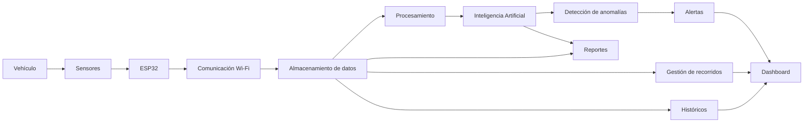

# 1. Diseño original de VECTRA

## 1.1 Descripción general del proyecto

VECTRA, cuyo nombre corresponde a *Vehicle Early-warning & Contextual Telemetry Recognition Analytics*, es un sistema IoT orientado al monitoreo, aprendizaje y detección de anomalías en el comportamiento de un vehículo.

La idea principal del proyecto consiste en convertir un vehículo convencional en una fuente de datos mediante un dispositivo IoT capaz de recopilar información durante los recorridos. A partir de estas mediciones, el sistema busca construir un modelo del comportamiento habitual del vehículo y posteriormente identificar desviaciones respecto a dicho comportamiento.

El objetivo inicial del proyecto no es realizar un diagnóstico mecánico definitivo, sino registrar información objetiva del vehículo, generar un historial de recorridos y detectar comportamientos que se alejen del patrón previamente aprendido.

## 1.2 Estructura conceptual actual

Actualmente, VECTRA se encuentra definido principalmente mediante una arquitectura conceptual. El flujo general del sistema parte del vehículo, continúa con los sensores y el dispositivo ESP32, posteriormente pasa al almacenamiento y análisis de datos y finalmente presenta la información mediante un dashboard.

El flujo general puede representarse de la siguiente manera:

```text
Vehículo
   ↓
Sensores
   ↓
ESP32
   ↓
Datos
   ↓
Inteligencia Artificial
   ↓
Dashboard
```

De manera funcional, el proyecto resume este proceso como:

```text
Medir → Comunicar → Almacenar → Analizar → Detectar → Visualizar
```

## 1.3 Responsabilidades actuales del sistema

Aunque VECTRA todavía no presenta en su documentación una implementación completa dividida en clases de software, sí existen responsabilidades claramente identificables dentro de su diseño conceptual.

### Sensores

Los sensores tienen la responsabilidad de obtener información física y contextual relacionada con el comportamiento del vehículo.

Las variables consideradas en el proyecto son:

- Aceleración en los ejes X, Y y Z.
- Vibración.
- Inclinación.
- Velocidad.
- Temperatura.
- Tiempo.
- Ubicación.

Estas mediciones constituyen la materia prima que posteriormente será procesada por el sistema.

### ESP32

El ESP32 funciona como dispositivo central del sistema IoT.

Sus responsabilidades principales son:

- Recibir las mediciones de los sensores.
- Coordinar la adquisición de información.
- Gestionar la comunicación inalámbrica.
- Enviar los datos hacia la plataforma cuando exista conectividad disponible.

### Comunicación

La parte de comunicación se encarga de transferir las mediciones generadas por el dispositivo IoT hacia la plataforma de procesamiento.

En la propuesta inicial se considera el uso de Wi-Fi para realizar esta comunicación.

### Almacenamiento de datos

El sistema debe conservar las mediciones generadas durante cada recorrido.

Cada recorrido produce una serie temporal que puede incluir:

- Marca de tiempo.
- Latitud.
- Longitud.
- Aceleración.
- Vibración.
- Inclinación.
- Temperatura.
- Velocidad.
- Identificador del recorrido.

La información almacenada posteriormente permitirá consultar históricos y realizar comparaciones entre diferentes recorridos.

### Procesamiento de datos

El procesamiento tiene la responsabilidad de organizar y preparar la información obtenida de los sensores para que pueda ser utilizada por otras partes del sistema.

Entre sus tareas se encuentran:

- Procesar series temporales.
- Comparar información de diferentes recorridos.
- Preparar los datos para el análisis.
- Facilitar el estudio de patrones de comportamiento.

### Inteligencia Artificial

La inteligencia artificial tiene como propósito analizar el comportamiento histórico del vehículo.

La secuencia conceptual propuesta es:

```text
Recopilar datos
      ↓
Aprender patrón normal
      ↓
Comparar recorrido
      ↓
Detectar desviación
```

La IA podría detectar comportamientos como:

- Vibraciones diferentes a las habituales.
- Aceleraciones atípicas.
- Cambios relacionados con determinados recorridos.
- Patrones que aparecen con mayor frecuencia antes de una anomalía.

Una anomalía detectada no necesariamente representa una falla mecánica, sino una diferencia significativa respecto al comportamiento previamente aprendido.

### Sistema de alertas

Cuando se detecta una desviación importante, el sistema debe generar una alerta para informar al usuario.

En la etapa inicial del proyecto se contempla principalmente una alerta visual.

### Dashboard

El dashboard tiene la responsabilidad de presentar la información procesada de forma comprensible.

El objetivo no es mostrar todos los datos crudos al usuario, sino convertir las mediciones en información útil mediante:

- Gráficas.
- Indicadores.
- Históricos.
- Estado del vehículo.
- Alertas.
- Información de los recorridos.

### Gestión de recorridos

VECTRA también debe administrar la información relacionada con los recorridos realizados por el vehículo.

Entre sus responsabilidades están:

- Registrar un recorrido.
- Asociar las mediciones con un recorrido.
- Consultar recorridos anteriores.
- Comparar recorridos.
- Mostrar el trayecto cuando se utilice GPS.

### Reportes

Otra responsabilidad identificada es la generación de reportes.

El sistema debe ser capaz de resumir la información relevante de un recorrido, permitiendo consultar posteriormente datos importantes y anomalías detectadas.

## 1.4 Funcionalidades identificadas

A partir del diseño actual, se identifican las siguientes funcionalidades principales:

1. Registrar recorridos.
2. Obtener mediciones de sensores.
3. Enviar o almacenar mediciones.
4. Visualizar información.
5. Consultar históricos.
6. Comparar recorridos.
7. Detectar anomalías.
8. Generar alertas.
9. Mostrar el recorrido mediante GPS.
10. Generar reportes.

Estas funcionalidades muestran que VECTRA no realiza una sola tarea, sino que combina adquisición de datos, comunicación, almacenamiento, procesamiento, análisis y visualización.

## 1.5 Diagrama del diseño original

El diseño original de VECTRA puede representarse de la siguiente manera:



## 1.6 Observación sobre el diseño original

Es importante aclarar que el proyecto se encuentra actualmente en una etapa conceptual y de prototipado.

Por esta razón, el diseño original presentado en este análisis se construye a partir de las responsabilidades funcionales y componentes definidos en la documentación de VECTRA, y no a partir de una implementación completa de clases ya desarrolladas.

Este análisis servirá como punto de partida para proponer posteriormente una estructura de software basada en clases pequeñas y especializadas.
